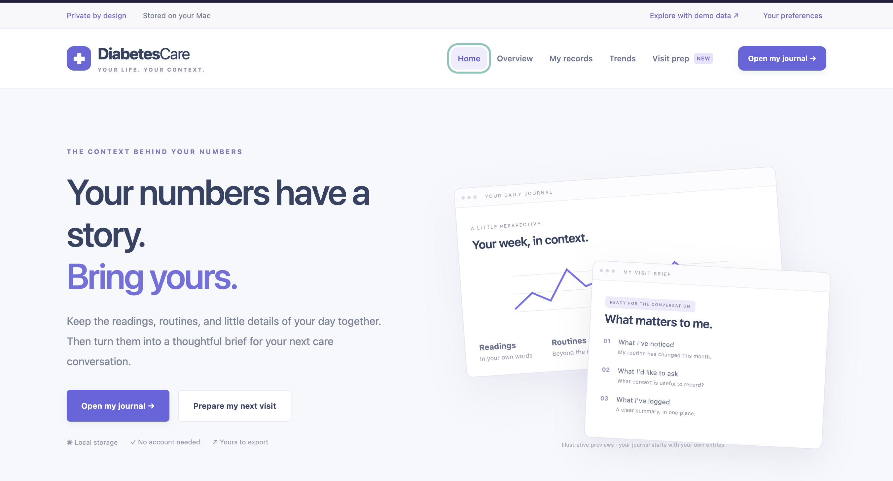

# DiabetesCare 3.0

**A Full-Stack Diabetes Journal and Health Tracking Application**

DiabetesCare is a locally hosted web application built with **C#, ASP.NET Core (.NET 10), HTML5, CSS3, and vanilla JavaScript**.

The application helps users organize manually recorded glucose readings, meals, medications, activities, symptoms, and appointment notes in one place.

It was developed as a software engineering project exploring full-stack development, REST-style APIs, data persistence, responsive interfaces, and automated testing.

## Technology Stack

| Layer | Technology |
|---|---|
| Backend | C#, ASP.NET Core Minimal APIs (.NET 10) |
| Frontend | HTML5, CSS3, JavaScript |
| API Communication | Fetch API, HTTP, JSON |
| Data Storage | Local JSON files, System.Text.Json |
| Visualization | SVG |
| Testing | Custom C# tests, Node.js built-in test runner |
| Development | Visual Studio Code, .NET CLI, Git |

No third-party runtime packages are required.

## Application Screenshots

### Homepage




## Key Features

**Health Journal**
- Record glucose readings with context, timestamps, and notes.
- Track meals, carbohydrate intake, medication records, physical activity, symptoms, and observations.
- Search and filter records by type, date, and keywords.
- Edit, soft-delete, restore, and undo changes.

**Glucose Trends and Visualization**
- Interactive SVG glucose charts.
- 7-, 14-, and 30-day chart periods.
- Daily and context-based summaries.
- Optional personal glucose limits.
- Support for mmol/L and mg/dL display units.

**Appointment Preparation**
- Organize questions and observations for healthcare appointments.
- Generate descriptive summaries over selected date ranges.
- Download appointment briefs or print them as PDFs.

**Data Management**
- Local JSON-based persistence.
- Serialized writes with temporary-file replacement.
- Previous-save backups and recovery.
- Migration support for legacy console application readings.
- CSV export, JSON backup, and isolated demo mode.

## Application Architecture

The application follows a three-layer design:

Browser Interface → ASP.NET Core Minimal API → JournalStore → Local JSON Storage

The browser communicates with the backend through HTTP requests using the Fetch API. The backend validates incoming data and manages persistence through a dedicated storage component.

### Main Components

| Component | Responsibility |
|---|---|
| `Program.cs` | Server configuration, API endpoints, validation, exports |
| `CareData.cs` | Record models and preferences |
| `JournalStore.cs` | Persistence, migrations, backups, recovery |
| `GlucoseReading.cs` | Legacy reading support |
| `wwwroot/index.html` | Application interface |
| `wwwroot/app.js` | Browser functionality and API requests |
| `wwwroot/visit.js` | Appointment preparation |
| `wwwroot/styles.css` | Responsive layouts and print styling |

Additional design information is available in `ARCHITECTURE.md`.

## Getting Started

**Prerequisites:** .NET 10 SDK

Clone the repository:

```bash
git clone https://github.com/zahyodeji44-droid/DiabetesCare.git
cd DiabetesCare
```

Run the application:

```bash
dotnet run
```

Open the locally displayed application URL, normally:

`http://127.0.0.1:5188`

No frontend dependency installation is required.

## Running Tests

Build the project:

```bash
dotnet build
```

Run the C# storage tests:

```bash
dotnet run --project tests/StoreTests/StoreTests.csproj
```

Run the JavaScript frontend tests (requires Node.js):

```bash
node --test tests/frontend.test.cjs
```

The automated checks cover storage persistence, migration, backup recovery, concurrent writes, filtering, CSV escaping, failed-save handling, and demo-mode isolation.

## Data Privacy and Recovery

DiabetesCare is designed to run locally, with records saved in an operating-system application data directory rather than uploaded to a cloud service.

On macOS, the default data location is normally:

`~/Library/Application Support/DiabetesCare/care-data.json`

The application maintains a previous-save backup and protects against overwriting unreadable journal files.

Personal journal files and backup data are excluded from version control.

For isolated testing, launch with:

```bash
dotnet run -- --data-dir /absolute/path/to/test-folder
```

## Design Reference

The homepage layout uses elements of Tidepool's publicly available webpage structure as a visual design reference. DiabetesCare uses its own branding, illustrations, copy, and application functionality and is not affiliated with Tidepool.

## Limitations

DiabetesCare is an educational, single-user application, not a medical device or clinical decision-support system.

It does not currently provide authentication, encryption, cloud synchronization, automatic glucose-meter integration, or treatment recommendations.

The application is intended for local use only and should not be exposed to a public network.

Charts and statistics reflect manually entered data and should not be interpreted as continuous glucose monitoring.

## Future Improvements

- Database-backed storage using SQL.
- Additional automated API integration tests.
- Expanded accessibility testing.
- Improved data import and export.
- Security enhancements for potential multi-user deployment.

## Project Status

Active development — portfolio and educational project.

**Developer:** Zahyad Kolawole

**GitHub:** https://github.com/zahyodeji44-droid